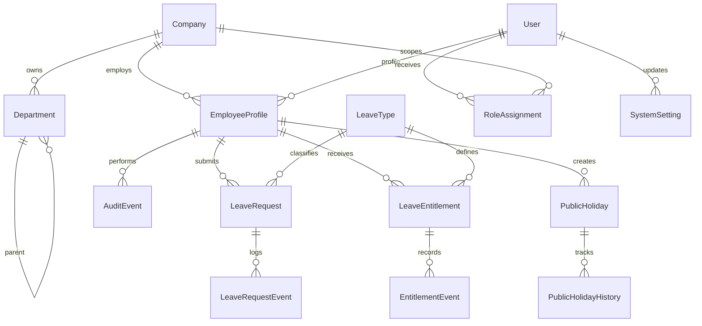

# Database Architecture

## 1. Current Reality
The current ORM layer already models the core leave domain and operational metadata. The schema is substantial but intentionally not overbuilt for unsupported phases. The implementation is ready for a Postgres primary database and supports a SQLite test fallback.

## 2. ERD Summary

## 3. Core Entities
- Company: legal entity / company boundary within the holding
- Department: hierarchical department or unit boundary
- EmployeeProfile: employee status and direct manager linkage
- RoleAssignment: active, auditable HR/admin/executive role and organization scope
- LeaveType: configurable leave category and operational behavior
- LeaveEntitlement: annual or policy-bounded leave allocation
- EntitlementEvent: append-only entitlement history
- LeaveRequest: request record with status, dates, working days, and decision metadata
- LeaveRequestEvent: append-only request lifecycle event log
- AuditEvent: general operational audit trail
- PublicHoliday: recurring or one-off holiday definitions
- PublicHolidayHistory: immutable holiday audit trail
- SystemSetting: admin-controlled policy configuration

## 4. Design Notes
- Primary keys use Django BigAutoField for future expansion.
- Important business keys are unique where required, such as company+department code and company+personnel code.
- Foreign keys use PROTECT to avoid accidental data loss.
- Critical operational data is append-only or protected from direct edits.
- DecimalField is used for working-day and entitlement values.
- Time zones are stored in UTC internally while using Asia/Tehran for local reporting.

## 5. Nice-to-have Future Entities
- OrganizationalUnit
- EmploymentContract
- WorkSchedule
- BackgroundJob
- Notification
- Attachment
- Comment

These are intentionally documented as future architecture dependencies, not forced into the current migration set. Company, site, department, employee scopes and role assignments are now present; richer unit hierarchies remain future work.

## 6. Constraints and Safety
- Avoid cascade deletes on employee and organizational records.
- Keep append-only history tables immutable.
- Store only necessary sensitive data; do not duplicate health or protected personal data in audit tables.
- Favor explicit checks over optimistic assumptions when an action changes leave status or policy.

## 7. Audit event and append-only policy
- Business-critical API/service mutations write `AuditEvent` through
  `leave.audit_services`; mutation and audit insert must share a transaction.
  Audit-write failure rolls back high-risk HR/admin business changes.
- Snapshot fields are allowlisted per entity. Passwords, tokens, email,
  Bradford note text, request rationale, comments, and attachment filenames
  are excluded. Add fields to the allowlist only after privacy review.
- `created_at` is database-generated. Actor comes from the authenticated
  server-side user; correlation ID is validated by backend middleware and
  source context is server-derived.
- `AuditEvent`, request comments/events, policy versions, and holiday history
  reject ORM updates/deletes and use database triggers for UPDATE/DELETE.
  Runtime database roles must not have permission to alter/drop these guards.
  INSERT access cannot be constrained by the append-only trigger and remains
  a database-role/deployment responsibility.
- Global administrators can read complete audit details. Scoped HR can query
  only currently in-scope employee-related events and receives redacted
  summaries. Ordinary users cannot query or mutate the audit log.
- Coverage is limited to inventoried application mutation paths; direct ORM,
  raw SQL, migration, shell, and future API/job writes must use the audit
  service or be separately classified. See
  [the audit coverage matrix](../remediation/AUDIT-COVERAGE-MATRIX.md).
