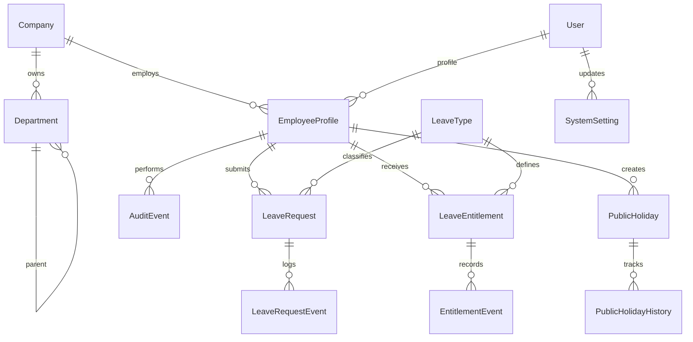

# Database Architecture

## 1. Current Reality
The current ORM layer already models the core leave domain and operational metadata. The schema is substantial but intentionally not overbuilt for unsupported phases. The implementation is ready for a Postgres primary database and supports a SQLite test fallback.

## 2. ERD Summary

## 3. Core Entities
- Company: legal entity / company boundary within the holding
- Department: hierarchical department or unit boundary
- EmployeeProfile: employee status and direct manager linkage
- LeaveType: configurable leave category and operational behavior
- LeaveEntitlement: annual or policy-bounded leave allocation
- EntitlementEvent: append-only entitlement history
- LeaveRequest: request record with status, dates, working days, and decision metadata
- LeaveRequestEvent: append-only request lifecycle event log
- AuditEvent: general operational audit trail
- PublicHoliday: recurring or one-off holiday definitions
- PublicHolidayHistory: immutable holiday audit trail
- SystemSetting: admin-controlled policy configuration

## 4. Design Notes
- Primary keys use Django BigAutoField for future expansion.
- Important business keys are unique where required, such as company+department code and company+personnel code.
- Foreign keys use PROTECT to avoid accidental data loss.
- Critical operational data is append-only or protected from direct edits.
- DecimalField is used for working-day and entitlement values.
- Time zones are stored in UTC internally while using Asia/Tehran for local reporting.

## 5. Nice-to-have Future Entities
- Site / WorkLocation
- OrganizationalUnit
- Role / Permission / RoleAssignment
- EmploymentContract
- WorkSchedule
- BackgroundJob
- Notification
- Attachment
- Comment

These are intentionally documented as future architecture dependencies, not forced into the current migration set.

## 6. Constraints and Safety
- Avoid cascade deletes on employee and organizational records.
- Keep append-only history tables immutable.
- Store only necessary sensitive data; do not duplicate health or protected personal data in audit tables.
- Favor explicit checks over optimistic assumptions when an action changes leave status or policy.
